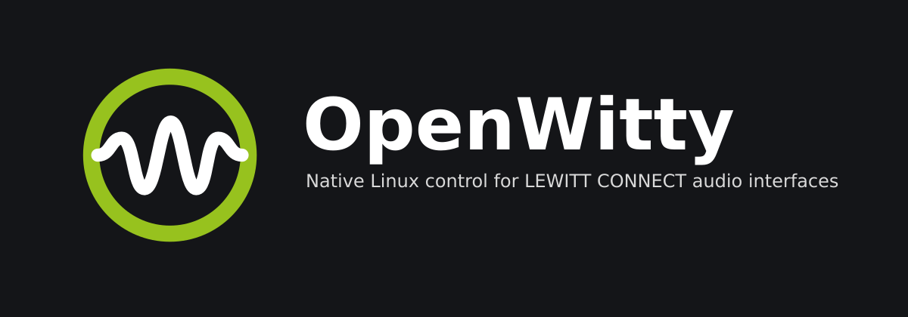

<p align="center"></p>

# OpenWitty

**Your interface. Your Linux. Your control.**

OpenWitty is an independent, open-source project bringing native Linux control to **LEWITT CONNECT audio interfaces**.

The project aims to provide an alternative to the proprietary LEWITT CONTROL CENTER software, allowing Linux users to configure and control their audio interfaces without relying on Windows, macOS, or virtual machines.

## Why OpenWitty?

LEWITT makes great audio hardware. Unfortunately, its CONTROL CENTER software is currently only available for Windows and macOS.

While CONNECT interfaces can retain their settings when moved between operating systems, Linux users currently need access to Windows or macOS for software-based configuration.

**OpenWitty aims to change that.**

By reverse engineering the communication protocol used by LEWITT CONTROL CENTER, this project aims to implement the necessary device controls natively on Linux.

This project is not about criticizing LEWITT or its software. It's about making great hardware more accessible to users of an operating system that isn't officially supported.

## Project Status

**Experimental alpha for the LEWITT CONNECT 2.** Tested with one CONNECT 2 on one Linux system
(CachyOS, Linux 7.3, KDE Plasma 6 on Wayland, PipeWire/WirePlumber). Treat everything else as untested.

What works on real hardware (one device, one system):

- **Live device state, read-only:** input gain and mute, speaker and headphone volume and mute, the
  monitoring mix, the selected channel, Panic Mute, and level meters (16 Hz settings / 48 Hz status
  polling). Hot-plug and reconnect.
- **Desktop volume integration:** the KDE/PipeWire volume of the CONNECT 2 follows the
  **speaker volume knob**, which Linux cannot see by itself (the device's volume read-back is
  broken). It is switched on in **Settings → Desktop integration**; the optional
  `openwitty-volumed` user service keeps it working while the window is closed and starts with
  the desktop session. Validated with the window open and closed, handing over between the two,
  at boot/login and across suspend/resume. It never writes the device.
- **Mute button and desktop slider work natively:** the kernel already passes the Mute button
  and desktop volume/mute changes between the device and the desktop. OpenWitty is not involved.
- **Kernel compatibility quirk (Linux 7.3):** on this kernel a broken microphone control of the
  device makes the desktop lose its hardware volume for the CONNECT 2. An optional, device-specific
  module option fixes that. OpenWitty explains and checks it, and never installs it.

Optional and limited:

- **Speaker/headphone control** (Settings, off by default, needs confirmation): OpenWitty's own
  faders then write the speaker and headphone volume and mute — only those bytes, at most 10 dB louder per
  step, read back. The underlying vendor write path is verified on hardware (via the CLI);
  the GUI option itself has not been exercised on hardware yet.
- **CLI writes** (`openwitty-cli write …`, explicit opt-in variables): LED brightness and speaker
  volume/mute were verified on hardware; instrument mute is prepared but never executed.
- **Vendor fallback** for the desktop volume (off by default): only for a device state in which
  the kernel's volume control is ignored. **Not validated on hardware.**

Not implemented or not validated:

- Most other controls (low-cut, 48 V, Clipguard, Denoise, Comp, LED colours, custom button, autogain/
  autosetup, sample-rate selection) work in the **simulated device** only; on the real device
  they are shown, not changed.
- Firmware update and factory reset are **deliberately not implemented**.
- **CONNECT 6 is not supported.**
- OpenWitty is **not a replacement** for LEWITT CONTROL CENTER.

## Device Support

| Device | Status |
|---|---|
| LEWITT CONNECT 2 | Experimental alpha: live state, desktop volume integration and the controls above validated with one device on one system |
| LEWITT CONNECT 6 | Not supported (the architecture keeps device support separable; nothing implemented) |

## Goals

- Provide native Linux control for LEWITT CONNECT audio interfaces.
- Understand and document the communication protocol used by LEWITT CONTROL CENTER.
- Enable device configuration without requiring Windows, macOS, or virtual machines.
- Support multiple CONNECT devices through an extensible architecture.
- Encourage community contributions and knowledge sharing.
- Keep the project free, transparent, and accessible.

## Features (CONNECT 2; mixed evidence levels)

- Device discovery and connection state, with clear permission/driver diagnostics (`EACCES` vs `EBUSY` vs stall)
- Input gain, mute, low-cut, Clipguard, 48 V, Clean/Warm/Vivid, Denoise, Compressor
- Loopback / speaker / headphone volume and mute, input–playback mix, dim, mono
- LED brightness and colours, custom-button function, settings preservation of unknown device bytes
- Autosetup / autogain workflow (simulated)
- Pending-edit tracking and merge with external device changes
- Desktop volume integration (Settings → Desktop integration, `openwitty-volumed`)

See [FEATURES.md](FEATURES.md) for the exact list and the evidence level of each row, and
[docs/VOLUME_INTEGRATION.md](docs/VOLUME_INTEGRATION.md) for the desktop volume integration.

## Install

See **[docs/INSTALLATION.md](docs/INSTALLATION.md)**: Arch/CachyOS package, Debian/Ubuntu package,
user-local install, USB permissions, the optional kernel quirk, desktop integration and uninstalling.

Try it without hardware:

```sh
cmake --preset release && cmake --build --preset release
ctest --preset release
build-release/src/gui/openwitty --mock      # simulated device, always labelled as simulated
```

With a connected CONNECT 2 and the USB permission rule installed, start `openwitty` without
`--mock`.

Further reading:

- [docs/RELEASE_READINESS.md](docs/RELEASE_READINESS.md) — what has been tested, known limitations
- [CHANGELOG.md](CHANGELOG.md) — draft release notes
- [DEVELOPMENT.md](DEVELOPMENT.md) — toolchain, presets, sanitizers
- [docs/USB_PERMISSIONS.md](docs/USB_PERMISSIONS.md) and [docs/USB_ACCESS.md](docs/USB_ACCESS.md) — udev, driver ownership
- [docs/HARDWARE_TEST_RESULTS.md](docs/HARDWARE_TEST_RESULTS.md) — the hardware evidence
- [PROTOCOL.md](PROTOCOL.md), [ARCHITECTURE.md](ARCHITECTURE.md), [docs/AUDIT_PHASE5E.md](docs/AUDIT_PHASE5E.md)

## Repository layout

| Path | Contents |
|---|---|
| `src/protocol`, `src/transport`, `src/core` | Qt-free core: message codecs, transports (libusb, mock), device session and write policy |
| `src/gui`, `src/cli` | Qt 6 / QML application, diagnostic CLI |
| `assets/` | OpenWitty branding (icons, banner) |
| `src/desktop`, `src/daemon` | desktop (ALSA) volume integration and the `openwitty-volumed` service |
| `packaging/` | Debian, Arch, desktop, AppStream, udev, systemd user unit, man pages |
| `tests/`, `tools/` | tests; packaging/audit/reverse-engineering tooling |
| `docs/` | engineering documentation |

## Philosophy

We believe choosing Linux shouldn't mean giving up control over your hardware.

OpenWitty is built around three simple ideas:

- **Freedom:** Use your hardware on the operating system of your choice.
- **Openness:** Share knowledge, document discoveries, and develop in public.
- **Community:** Build solutions together where official support is unavailable.

**Made for Linux. Open for everyone.**

## Contributing

Contributions, ideas, protocol discoveries, testing, and documentation are welcome.

Whether you're experienced in reverse engineering, audio programming, USB communication, or simply interested in helping, your involvement is appreciated.

More detailed contribution guidelines will be added as the project evolves.

## License

OpenWitty is released under the **MIT License**.

See [LICENSE](LICENSE) for details, and [docs/THIRD_PARTY.md](docs/THIRD_PARTY.md) for dependencies and asset notes.

## Disclaimer

OpenWitty is an independent, community-driven open-source project.

**This project is not affiliated with, sponsored by, or endorsed by LEWITT GmbH.**

LEWITT, CONNECT, and CONTROL CENTER are trademarks or product names of their respective owners.

All trademarks are used solely for identification and compatibility purposes.

OpenWitty does not distribute proprietary LEWITT software or firmware, and does not use LEWITT artwork.

---

*Made for Linux. Open for everyone.*
