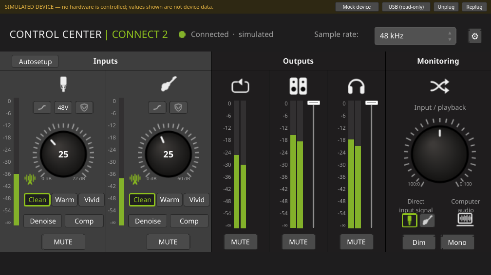
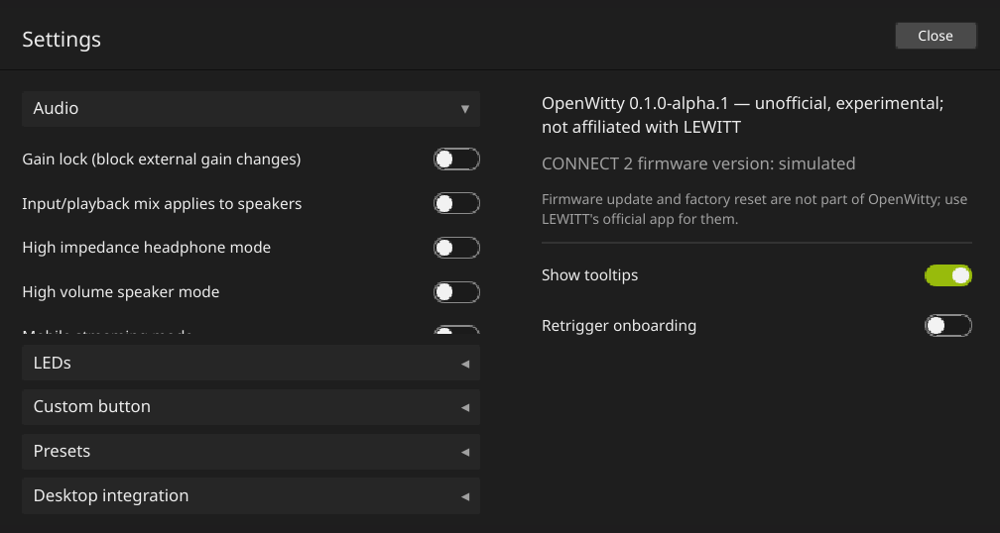

<p align="center"></p>

# OpenWitty

**Linux control for the LEWITT CONNECT 2.**

> [!IMPORTANT]
> **OpenWitty is unofficial.** It is an independent community project, not made, supported or endorsed by
> LEWITT. For official software and support, see [lewitt-audio.com](https://www.lewitt-audio.com).

LEWITT's CONTROL CENTER app is available for Windows and macOS only. OpenWitty brings the same controls
to Linux: gain, processing, monitoring, outputs, LEDs and presets for the CONNECT 2, plus a desktop integration
that makes the interface feel at home on a Linux desktop.

<p align="center"></p>

## Features

**Device control.** Every setting below was verified on a real CONNECT 2:

- Inputs: gain (with gain lock), mute, low-cut, Clipguard, Clean / Warm / Vivid, Denoise with noise-floor
  measurement, Comp, 48 V phantom power
- Monitoring: direct input source, input/playback mix, Dim, Mono, loopback mute
- Outputs: speaker and headphone volume and mute, high-volume speaker mode, high-impedance headphone mode
- LEDs: brightness and colours; custom button function
- Autosetup: gain measurement, optional 48 V and ambient-noise test
- Presets: save and load your settings
- Live view: the window follows changes made on the device and shows level meters

**Desktop integration** (Settings ▸ Desktop integration):

- The desktop volume follows the CONNECT 2's volume knob, and the volume keys control the output you can hear
  (speakers or headphones)
- An optional background service keeps this working while the window is closed
- An optional tray icon shows whether the CONNECT 2 is connected
- Readable names in the desktop and in audio apps: "CONNECT 2 Output", and separate "Microphone",
  "Instrument" and "Loopback" inputs; DAWs show named channels
- Optional: a desktop microphone mute that really mutes the input
- Optional: open the window at login and reopen it where it was closed

**Built-in safety.** OpenWitty writes only the settings it knows and reads every change back. Large volume
and gain increases go in steps, and 48 V or louder output modes ask before they switch on. Firmware update and
factory reset are not part of OpenWitty.

<p align="center"></p>

## Tested on

| | |
|---|---|
| Device | LEWITT CONNECT 2 (one unit, firmware 1.21) |
| System | CachyOS, Linux 7.3 |
| Desktop | **KDE Plasma 6.8 on Wayland** |
| Audio | PipeWire 1.6, WirePlumber 0.5 |
| Packages | Arch Linux package on CachyOS; Debian package on Debian 13 (build, install, start, removal; without the device) |

Other distributions and desktops have not been tested. The device control works with any desktop. The desktop
integration was developed for **KDE Plasma with PipeWire/WirePlumber**; on other desktops expect differences:

- The tray icon needs a desktop with a system tray (on GNOME, an AppIndicator extension).
- "Reopen the window where it was closed" works on KDE Plasma and in X11 sessions only, because other Wayland
  desktops do not let apps place their own windows.

Reports from other systems are welcome. Please open an issue.

## Install

Download the package for your system from the
**[latest release](https://github.com/st0nebyte/openwitty/releases/latest)**:

```sh
# Arch Linux / CachyOS
sudo pacman -U openwitty-0.1.0-1-x86_64.pkg.tar.zst

# Debian 13 (trixie); needs Qt 6.8 or newer
sudo apt install ./openwitty_0.1.0-1_amd64.deb
```

The packages include the USB permission rule, so the CONNECT 2 is accessible right away (replug it once after
installing). Then start **OpenWitty** from the application menu.

**Linux 7.3 users:** this kernel loses the desktop hardware volume of the CONNECT 2 because of a broken
microphone control on the device. OpenWitty detects this and explains the optional fix (one module option) in
Settings ▸ Desktop integration.

Building from source, a user-local install without root, the optional desktop files and uninstalling:
**[docs/INSTALLATION.md](docs/INSTALLATION.md)**.

Try it without the hardware:

```sh
openwitty --mock          # simulated device, always labelled as simulated
```

## Not supported

- The CONNECT 6 and other LEWITT devices
- macOS streaming mode, firmware update and factory reset (use LEWITT's official app for those)
- Audio itself is handled by Linux (USB Audio Class 2 through the kernel and PipeWire/JACK); OpenWitty controls
  the device's settings, not the audio streams. There is no ASIO driver on Linux, and none is needed.

## Documentation

- [docs/INSTALLATION.md](docs/INSTALLATION.md): install, USB permissions, kernel fix, desktop integration, uninstall
- [docs/VOLUME_INTEGRATION.md](docs/VOLUME_INTEGRATION.md): how the desktop volume follows the knob
- [FEATURES.md](FEATURES.md): every feature with the evidence for it
- [PROTOCOL.md](PROTOCOL.md): the CONNECT 2's control protocol as far as it is understood
- [ARCHITECTURE.md](ARCHITECTURE.md), [DEVELOPMENT.md](DEVELOPMENT.md), [TESTING.md](TESTING.md): for developers
- [CHANGELOG.md](CHANGELOG.md): release notes
- [docs/dev/](docs/dev/): the development history, hardware test logs and research notes

## Repository layout

| Path | Contents |
|---|---|
| `src/protocol`, `src/transport`, `src/core` | Qt-free core: message codecs, USB and simulated transports, device session, write rules |
| `src/gui`, `src/tray`, `src/cli` | Qt 6 / QML application, tray icon, command-line tool |
| `src/desktop`, `src/daemon` | desktop (ALSA/PipeWire) integration and the `openwitty-volumed` background service |
| `packaging/` | Arch, Debian, desktop entry, AppStream, udev, systemd, WirePlumber, man pages |
| `tests/`, `tools/` | tests; packaging, audit and research tools |

## Contributing

Bug reports, tests on other systems and protocol findings are welcome as
[issues](https://github.com/st0nebyte/openwitty/issues); questions and ideas in
[Discussions](https://github.com/st0nebyte/openwitty/discussions). Code is written by the maintainers; see
[CONTRIBUTING.md](CONTRIBUTING.md). Security problems: [SECURITY.md](SECURITY.md).

## License

MIT: see [LICENSE](LICENSE), and [docs/THIRD_PARTY.md](docs/THIRD_PARTY.md) for dependencies and icons.

## Disclaimer

OpenWitty is an independent, community-driven open-source project. **It is not affiliated with, sponsored by,
supported by or endorsed by LEWITT GmbH.** LEWITT, CONNECT and CONTROL CENTER are trademarks or product names of
their respective owners and are used here only to identify the hardware OpenWitty works with. OpenWitty contains
no LEWITT software, firmware or artwork.
